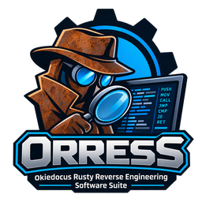
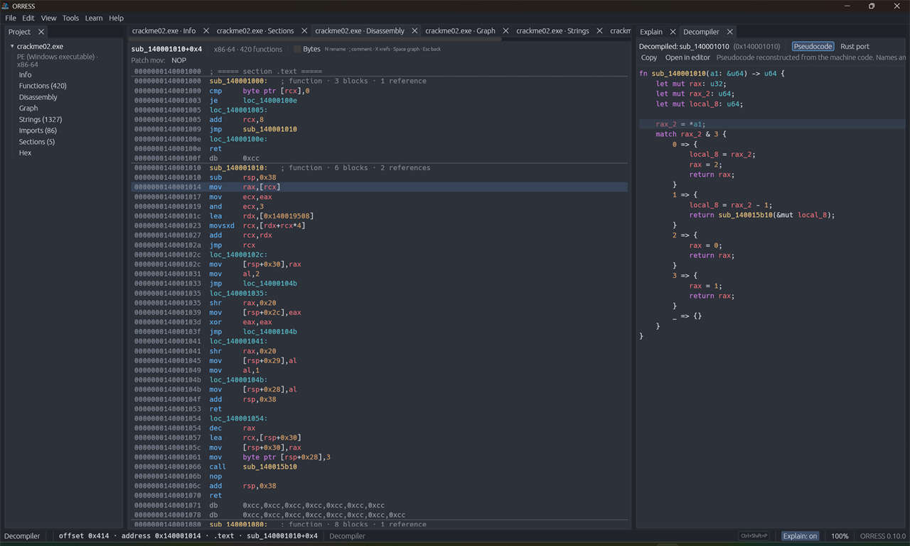
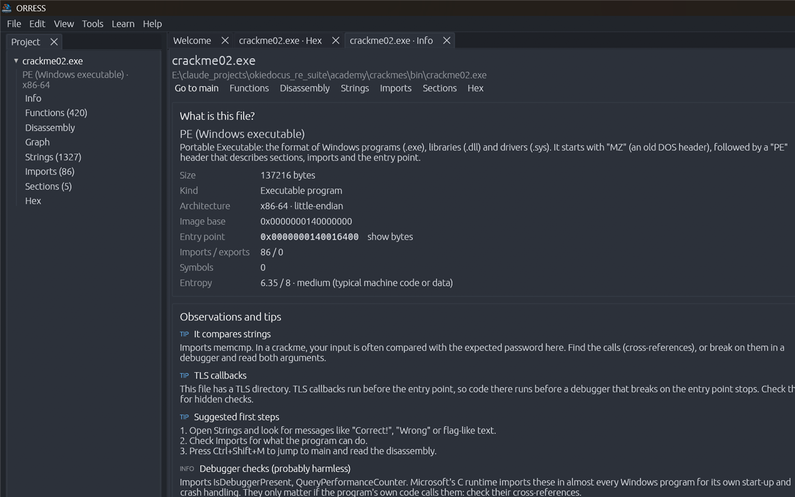
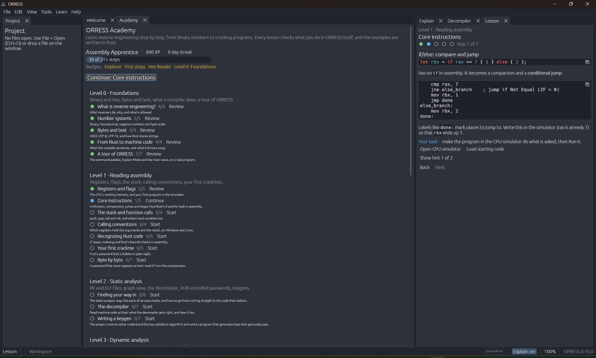
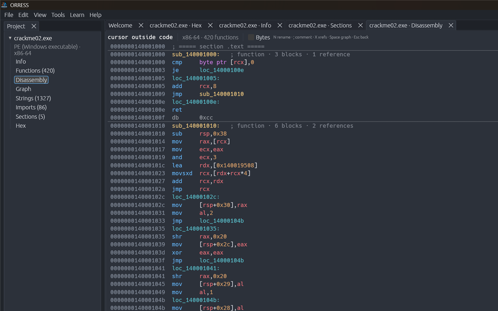
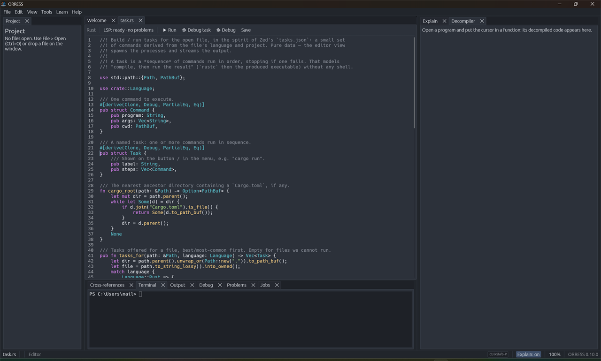

<div align="center">



# ORRESS

**Okiedocus Rusty Reverse Engineering Software Suite**

A reverse-engineering IDE for CTF players, malware analysts and the curious —
written in pure Rust, with a decompiler that speaks **Rust** and a built-in course that takes you from zero to expert.

[](https://github.com/okiedocus/orress/actions/workflows/ci.yml)




</div>

---

## Why ORRESS?

- **Approachable.** Hover anything and ORRESS explains it. The built-in **Academy** (8 levels,
  37 lessons, practice crackmes, a CPU simulator) teaches reverse engineering inside the tool you
  are learning.
- **Complete.** Hex editor, disassembler, graph view, decompiler, debugger, emulator, symbolic
  solver, malware triage, YARA, sandbox, binary diffing, devirtualization, code editor, terminal
  — in one fast native app.
- **Rust all the way down.** Pure-Rust engines (no IDA, Ghidra, Unicorn or Python required). The
  decompiler prints **Rust syntax** and can emit a **compilable Rust port** of a function.
- **Built to be extended.** Every feature is an action reachable from the menu, the command palette
  and a rebindable shortcut. Rhai scripting, an MCP server for AI agents, and **Zed-extension
  compatibility** (themes, grammars, language servers, WASM extensions).
- **Zed-inspired workspace.** Docks, panes, splits, a command palette and Zed-format keymaps and
  themes — built on [egui](https://github.com/emilk/egui).

> **Status: v1.0.** All planned feature milestones are implemented. A few platform-specific features
> are still marked experimental (see [Platform support](#platform-support)); bug reports are very welcome.

## Contents

- [Features](#features)
- [Getting started](#getting-started)
- [First steps](#first-steps)
- [The decompiler](#the-decompiler)
- [Command line](#command-line)
- [AI integration](#ai-integration)
- [Malware analysis safely](#malware-analysis-safely)
- [Configuration](#configuration)
- [Architecture](#architecture)
- [Contributing](#contributing)
- [License](#license)

## Features

### Load and inspect
- **Formats:** PE, ELF and Mach-O, plus **.NET** (CIL), **Java** `.class`, **Android** DEX/APK
  (smali), **Python** `.pyc`, **WebAssembly** (WAT), **ZIP/JAR** (including ZIP64) and a
  **JavaScript** deobfuscator.
- **Hex editor** with a data inspector, entropy graph, wildcard byte search (`E8 ?? ?? ?? ??`) and
  in-place patching.
- **"What is this file?"** card: format, architecture, protections, compiler/packer detection,
  sections, imports and strings.

### Disassemble and decompile
- Recursive-descent disassembly for **x86, x86-64 and ARM64**, with functions, cross-references,
  jump-table recovery, a control-flow **graph view**, renames, comments and bookmarks saved per file.
- A **decompiler with its own IR** that prints readable Rust: structured control flow, recovered
  types, slices, structs, iterators and SIMD/float support — see [The decompiler](#the-decompiler).
- **Deobfuscation:** opaque-predicate folding and control-flow unflattening.
- An **assembler** (x86-64 and ARM64) for patching instructions in place.

### Run, debug and solve
- **Debugger:** native Windows back end (Win32 Debug API) and a Linux `ptrace` back end
  (experimental), with breakpoints, stepping, registers, stack and memory editing.
- **Emulator:** a pure-Rust x86-64 CPU emulator — run a single function with arguments, with
  common libc calls stubbed out. **Time-travel debugging** lets you scrub backwards and forwards
  through a recorded trace.
- **Solvers:** an instruction-count side-channel solver, **symbolic/concolic execution** with
  SMT-LIB2 export, and one-click **VM devirtualization** that recovers a bytecode VM's key and its
  per-byte checks.
- **Shellcode workbench:** paste a blob (hex, C array, `\x`, base64), disassemble it, emulate it and
  identify API hashes.

### Malware analysis
- **Triage report:** capabilities mapped to **MITRE ATT&CK**, defanged IOCs, hashes (imphash, TLSH,
  ssdeep), config extraction and graded hints, exportable as Markdown.
- **YARA-X** workbench: write, generate and run rules against files, folders or a live process.
- **Sandbox:** a guarded launcher that refuses to run outside a VM, a built-in **fake network**
  (DNS + HTTP), VirtualBox snapshot control and an ETW activity monitor.

### Write code and collaborate
- **Code editor:** multi-cursor, rope-backed, tree-sitter highlighting, **LSP** (rust-analyzer,
  pyright, clangd: diagnostics, hover, go-to-definition, completion), build/run tasks,
  **DAP** source-level debugging and an integrated **terminal**.
- **Workbench:** CyberChef-style recipes (`from_base64 | xor key=0x5a | zlib_inflate`) with a
  **Magic** mode that finds the decoding for you.
- **Binary diffing:** BinDiff-style function matching for patch diffing and variant comparison.
- **Collaboration:** real-time shared sessions (CRDT, presence, follow mode) over a self-hostable,
  end-to-end-encrypted relay, plus **CTFd / rCTF** import and flag submission.
- **Challenge Workbench:** author your own crackme and submit it to a CTF platform from inside
  ORRESS.

<table>
<tr>
<td></td>
<td></td>
</tr>
<tr>
<td align="center"><sub>Static triage with MITRE ATT&amp;CK mapping</sub></td>
<td align="center"><sub>The built-in Academy</sub></td>
</tr>
<tr>
<td></td>
<td></td>
</tr>
<tr>
<td align="center"><sub>Disassembly with explanations</sub></td>
<td align="center"><sub>The built-in editor with live LSP</sub></td>
</tr>
</table>

## Getting started

There are no prebuilt binaries yet, so build from source. You need
[Rust via rustup](https://rustup.rs); the repository pins its toolchain (`rust-toolchain.toml`), and
rustup installs it automatically on the first build.

```sh
git clone https://github.com/okiedocus/orress.git
cd orress
cargo run --release -p orress                # start the app
cargo run --release -p orress -- crackme.exe # start and open a file
```

**Linux** needs the GUI development libraries first:

```sh
sudo apt install libxkbcommon-dev libgtk-3-dev libwayland-dev   # Debian / Ubuntu
```

Optional extras:

| Want | Install |
|---|---|
| Rust / Python / C language servers in the editor | `rust-analyzer`, `pyright`, `clangd` on your `PATH` |
| AI assistant on your Claude plan | [Claude Code](https://claude.com/claude-code), signed in |
| "Check compiles" button for Rust ports | build with `--features compile-check` |
| Harder symbolic constraints | `z3` (ORRESS exports SMT-LIB2) |

Run the test suite with `cargo test --workspace`.

### Platform support

| | Windows | Linux | macOS |
|---|---|---|---|
| App, analysis, decompiler, emulator, editor | ✅ | ✅ | untested |
| Native debugger | ✅ 64-bit targets | ⚠️ experimental (`ptrace`, x86-64) | — |
| Sandbox (process-tree containment) | ✅ Job Objects | ✅ process groups | untested |
| ETW activity monitor | ✅ (needs admin) | — | — |

32-bit Windows programs can't be debugged natively yet; use the emulator for those.

## First steps

New to reverse engineering? Open **Learn → Academy** and start at Level 0. Otherwise:

| Do this | How |
|---|---|
| Run any command | `Ctrl+Shift+P` — the command palette |
| Open a file | `Ctrl+O`, or drag it onto the window |
| What is this file? | `Ctrl+I` |
| Strings / functions | `Ctrl+Shift+S` / `Ctrl+Shift+F` |
| Disassembly / go to `main` | `Ctrl+D` / `Ctrl+Shift+M` |
| Graph view | `Space` in the disassembly |
| Rename, comment, bookmark, xrefs | `N`, `;`, `B`, `X` in the disassembly |
| Decompile the current function | `F5` |
| Debug / emulate / shellcode | `F6` / `F7` / `F8` |
| While debugging | `F5` continue · `F10` step over · `F11` step into · `Shift+F5` stop |
| Malware triage / YARA | `Ctrl+Shift+T` / `Ctrl+Shift+Y` |
| Go to an address | `Ctrl+G` (hex by default, `#123` decimal, `+10` relative) |
| Find bytes or text | `Ctrl+F`, then `F3` / `Shift+F3` |
| Show/hide docks | `Ctrl+B` left, `Ctrl+Alt+B` right, `Ctrl+J` bottom |
| Every shortcut | `F1` |

Hover over anything for an explanation; the **Explain** panel keeps the text while you work.

## The decompiler

`F5` opens the decompiler next to the disassembly, and the two follow each other: move through
the listing and the matching line lights up. For the password check of the Academy's second
crackme it prints:

```rust
fn sub_140001100(a1: &[u8]) -> bool {
    if a1.len() != 7 {
        return false;
    }
    if a1[0] != b'R' {
        return false;
    }
    // ...
    return a1[6] == b'3';
}
```

Machine code is lifted into ORRESS's own IR, simplified, structured into
`if`/`while`/`for`/`match`/labelled loops, typed from how values are used and printed as Rust.
Highlights:

- **Rust-shaped types:** pointer + length pairs become `&[T]`/`&str`, read-only and written
  pointers become `&T`/`&mut T`, constant-offset access recovers `#[repr(C)]` structs, and
  signedness is inferred.
- **Idioms, not instructions:** counted loops become `for x in s`, accumulations become
  `.iter().sum()` / `.fold(..)` / `.any(..)`, jump tables become `match`, and `rep movs`/`stos`/`cmps`
  become `memcpy`/`memset`/`memcmp`.
- **Vectorised code folds back:** SSE2 loops, float and integer, with their horizontal-reduce tails
  are *proved* to compute a whole-slice reduction and collapse to a one-line `s.iter()…` call.
- **Floating point and SIMD:** scalar SSE/NEON floats with `f32`/`f64` signatures, and packed SSE as
  lane arrays.
- **Three architectures:** x86-64, x86 and ARM64, sharing one pipeline.
- **Honest output:** what can't be expressed is shown as `read::<u32>(addr)`, `unknown(..)` or
  inline `asm!`, never guessed.

**Rust port mode** turns a function into a *compilable* Rust scaffold. A tiny `orress_rt` prelude
supplies memory helpers. Instructions the lifter can't model are kept as `core::arch::asm!` with
their register inputs and outputs wired up, and every external call or global is stubbed so the
file compiles as-is. Use it as the starting point for porting legacy code to Rust.

## Command line

`orress-cli` runs the same engines from a terminal. Input is a file, or standard input when it is
omitted or `-`.

```sh
orress-cli info crackme.exe [--json]          # what is this file?
orress-cli strings crackme.exe -n 6 --flags   # strings, or only flag-like ones
orress-cli funcs crackme.exe                  # functions found
orress-cli disasm crackme.exe main            # a function by name, `main`, `entry` or 0xADDR
orress-cli decompile crackme.exe main         # ... as Rust
orress-cli vm crackme.exe                     # detect and devirtualize a bytecode VM
orress-cli script crackme.exe solve.rhai      # run a Rhai script (or -e "function_count()")
orress-cli recipe "from_base64 | xor key=0x41" payload.txt
orress-cli magic payload.txt                  # find a decoding automatically
orress-cli patch crackme.exe 0x81a 75 -o cracked.exe
orress-cli ops                                # list every workbench operation
```

There are also [rsbkb](https://github.com/trou/rsbkb)-style shortcuts: `xor`, `b64`, `hex`, `url`,
`rc4`, `hash`, `entropy`, `slice`, `bgrep`, `tsdec`.

## AI integration

**The Assistant panel** (*View → Open View → AI Assistant*) answers questions about the open
binary. Bring your own model:

| Backend | Notes |
|---|---|
| **Claude plan (CLI)** | Runs the `claude` CLI headless with your signed-in account, including Claude Pro/Max — **no API key needed** |
| **Claude API** | Anthropic API key from the field or `ANTHROPIC_API_KEY` |
| **OpenAI-compatible / local** | OpenAI, Azure, or a local model (Ollama, LM Studio, llama.cpp, vLLM) by base URL |
| **Offline** | Answers from ORRESS's own static analysis; nothing leaves your machine |

Sending context is **opt-in**: the panel shows exactly what will be sent (an analysis summary,
never the raw file). API keys are kept for the session only unless you tick **Remember key**, which
stores the key in plaintext in `ai.json`.

**MCP server.** `orress-mcp` exposes ORRESS's engines to AI agents such as Claude Code over the MCP
stdio transport. Add it to a project's `.mcp.json`:

```json
{
  "mcpServers": {
    "orress": { "command": "cargo", "args": ["run", "-q", "--release", "-p", "orress-mcp"] }
  }
}
```

Tools: `triage`, `strings`, `disassemble` (WASM, `.pyc`, `.class`, .NET, DEX), `detect_vm`,
`deobfuscate_js`, `archive_list` and `binary_diff`. The server only reads the files it is asked to,
and never executes them.

## Malware analysis safely

The **Sandbox** runs a sample as a real process, so detonate live malware only with ORRESS
running **inside a disposable VM**. ORRESS enforces this: the Sandbox refuses to launch unless it
detects a VM.

1. Install a hypervisor on the host: **VirtualBox**, **VMware** or **QEMU/KVM**. These are detected
   unambiguously; on a Windows 11 host, Hyper-V-style detection is ambiguous, see below.
2. Create a throwaway guest, install the guest additions, and set its network to
   **host-only/internal** — never bridged or NAT.
3. Build ORRESS inside the guest and **take a clean snapshot**.
4. Set the guest's DNS server to `127.0.0.1`. In the Sandbox tab, click **Start fake network**,
   choose the sample, confirm, and click **Run in sandbox**. Every DNS query and HTTP request the
   sample makes is answered locally and logged.
5. **Revert to the snapshot** after every run.

> **Hyper-V note:** Windows 11's virtualization-based security makes a *physical* host report the
> `Microsoft Hv` hypervisor too, so ORRESS treats Hyper-V as unconfirmed by default. If you really
> are inside a Hyper-V guest, untick **Refuse to run outside a VM** in the Sandbox policy.

Static analysis (triage, YARA, disassembly, emulation) never executes the sample and is safe on any
machine.

## Configuration

**Help → Open Config Folder** opens the config folder (`%APPDATA%\okiedocus\ORRESS\config` on
Windows, `~/.config/orress` on Linux).

| File | Purpose |
|---|---|
| `settings.json` | Theme, zoom, Explain Mode, recent files, language-server overrides |
| `keymap.json` | Your shortcuts in **Zed's keymap format**; they override the defaults |
| `themes/*.json` | Custom themes — ORRESS themes or **Zed theme families** directly |
| `lsp/*.json` | Language-server adapter manifests (add or override a server for any language) |
| `extensions/<name>/` | Installed **Zed extensions** (themes, grammars, language servers, WASM) |
| `projects/*.orress` | Your names, comments, bookmarks and patches, saved per file (by SHA-256) |
| `academy.json` | Academy progress |

Example `keymap.json`:

```json
[
  { "context": "Global", "bindings": { "ctrl-p": "command_palette::Toggle" } },
  { "context": "Hex", "bindings": { "ctrl-w": null } }
]
```

Action names are listed on the Keyboard Shortcuts page (`F1`). Extensions can be installed from a
git URL or a local folder via the command palette → **Manage Extensions**.

## Architecture

ORRESS is a Cargo workspace of focused crates; the app is a thin shell over reusable engines.

| Layer | Crates |
|---|---|
| **App & UI** | `orress` (app), `orress-workspace` (docks, panes), `orress-views` (every view), `orress-ui`, `orress-theme`, `orress-actions` (actions, keymaps), `orress-settings` |
| **Loading** | `orress-loaders` (PE/ELF/Mach-O), `orress-bytes`, `orress-archive`, `orress-dotnet`, `orress-java`, `orress-dex`, `orress-pyc`, `orress-wasm`, `orress-js` |
| **Analysis** | `orress-arch` (decoding), `orress-analysis` (functions, CFG, xrefs), `orress-decompiler`, `orress-asm` (assembler), `orress-diff`, `orress-vm` (devirtualization) |
| **Dynamic** | `orress-debug`, `orress-emu` (emulator + time travel), `orress-sym` (symbolic execution) |
| **Malware** | `orress-triage`, `orress-sandbox` |
| **Editor & tools** | `orress-editor`, `orress-lsp`, `orress-dap`, `orress-term`, `orress-transforms` (workbench) |
| **Extend & connect** | `orress-ext` (Zed extensions, WASM host), `orress-script` (Rhai), `orress-ai`, `orress-mcp`, `orress-collab`, `orress-relay`, `orress-ctf`, `orress-challenge` |
| **Learn & project** | `orress-academy`, `orress-project` (documents, annotations) |
| **Binaries** | `orress` (GUI), `orress-cli`, `orress-mcp`, `orress-relay` |

Every user-facing operation is an **action** with a plain-language explanation
(`crates/orress/src/actions.rs`). Menus, the palette, shortcuts and buttons all dispatch through
the same path, so a new feature shows up everywhere at once. Academy lessons are TOML files in
[`academy/lessons/`](academy/lessons) and the practice crackmes are Rust programs in
[`academy/crackmes/`](academy/crackmes).

## Contributing

Issues and pull requests are welcome. Before opening a PR:

```sh
cargo fmt --all
cargo clippy --workspace --all-targets -- -D warnings
cargo test --workspace
```

CI runs the same three checks on Windows and Linux. Please keep the project **pure Rust** — new
dependencies that pull in C/C++ toolchains need a strong reason.

## License

Licensed under either of [Apache License 2.0](LICENSE-APACHE) or [MIT](LICENSE-MIT), at your
option. ORRESS follows Zed's design but contains no Zed source code.

Unless you explicitly state otherwise, any contribution you intentionally submit for inclusion in
ORRESS shall be dual licensed as above, without any additional terms or conditions.
